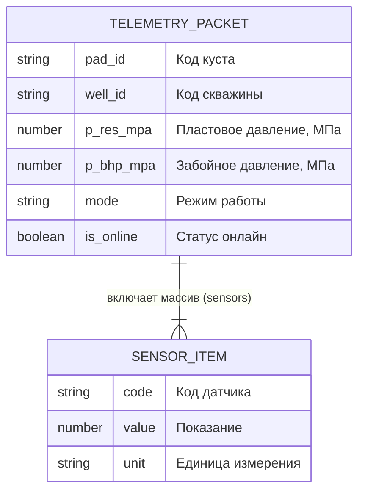

# Практическое занятие № 2. Этап 1

**Дисциплина:** Программирование и прототипирование ИТ-решений  
**Направление:** 09.03.03 Прикладная информатика  
**Траектория:** Вариант Б (Продвинутая)  
**Индивидуальный параметр:** N = 8 (Студент 1: 6, Студент 2: 2)  

## 1. Словарь данных (Data Dictionary)

| Поле (путь JSON) | Описание смысла поля | Тип Python | Тип JSON | Обяз.? | Ваше значение (N=8) |
| :--- | :--- | :--- | :--- | :--- | :--- |
| **pad_id** | Номер кустовой площадки | str | string | Да | "PAD-18" |
| **well_id** | Код скважины | str | string | Да | "W-208" |
| **p_res_mpa** | Пластовое давление, МПа | float | number | Да | 26.0 |
| **p_bhp_mpa** | Забойное давление, МПа | float | number | Да | 15.2 |
| **mode** | Режим эксплуатации скважины | str | string | Да | "PUMPING" |
| **is_online** | Признак связи со станцией (Челлендж 1) | bool | boolean | Да | true |
| **sensors** | Список замеров с датчиков | list[dict] | array | Да | [{...}, {...}, {...}] |
| **sensors[].code** | Код датчика в массиве | str | string | Да | "T-01", "Q-01", "P-01" |
| **sensors[].value** | Измеренное показание датчика | float | number | Да | 57.0, 92.0, 14.0 |
| **sensors[].unit** | Единица измерения датчика | str | string | Да | "C", "m3/d", "MPa" |

## 2. ER-диаграмма сущностей (Mermaid)

