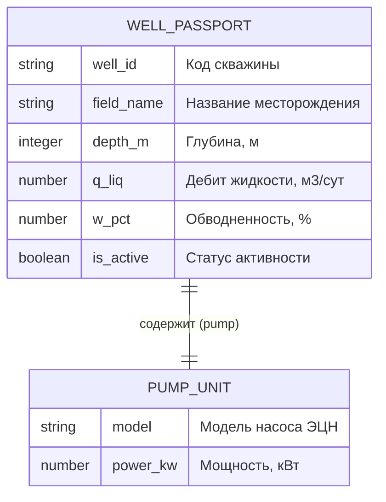

# Практическое занятие № 2. Этап 1

**Дисциплина:** Программирование и прототипирование ИТ-решений  
**Направление:** 09.03.03 Прикладная информатика  
**Траектория:** Вариант А (Базовая)  
**Индивидуальный параметр:** N = 8 (Студент 1: 6, Студент 2: 2)  

## 1. Словарь данных (Data Dictionary)

| Поле (ключ) | Описание смысла поля | Тип Python | Тип JSON | Обяз.? | Ваше значение (N=8) |
| :--- | :--- | :--- | :--- | :--- | :--- |
| **well_id** | Идентификатор (код) скважины | str | string | Да | "W-108" |
| **field_name** | Название месторождения (Челлендж 1) | str | string | Да | "Приобское" |
| **depth_m** | Глубина скважины, м | int | integer | Да | 1900 |
| **q_liq** | Суточный дебит жидкости, м³/сут | float | number | Да | 73.0 |
| **w_pct** | Обводнённость продукции, % | float | number | Да | 28.0 |
| **is_active** | Признак работы скважины | bool | boolean | Да | true |
| **pump** | Вложенный объект: погружной насос | dict | object | Да | {...} |
| **pump.model** | Модель насоса ЭЦН | str | string | Да | "ЭЦН5-80-1800" |
| **pump.power_kw** | Мощность насоса, кВт | float | number | Да | 80.0 |

## 2. ER-диаграмма сущностей (Mermaid)

